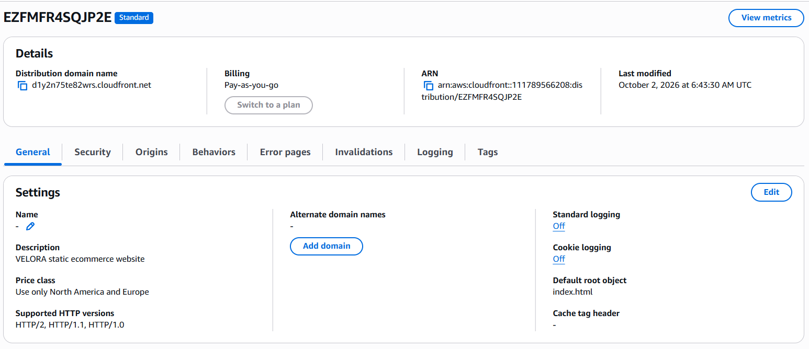
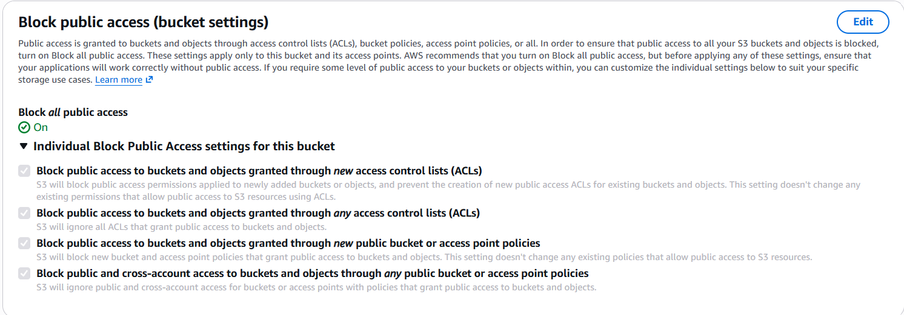
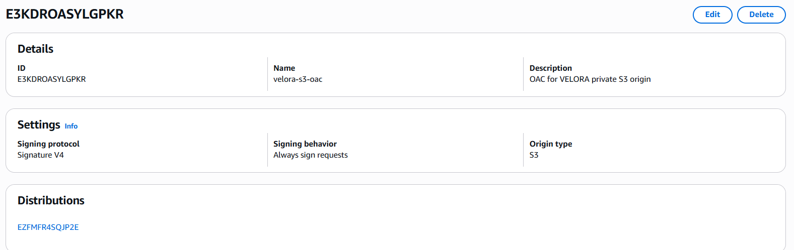
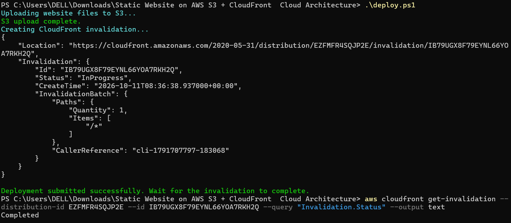

# VELORA — AWS Static Website Delivery

An end-to-end cloud engineering project demonstrating how to host and securely deliver a static website using Amazon S3, Amazon CloudFront, Origin Access Control (OAC), HTTPS, and automated deployment with AWS CLI and PowerShell.

**Live website:** https://d1y2n75te82wrs.cloudfront.net  
**GitHub repository:** https://github.com/Abhiingit/velora-cloud-project-showcase

---

## Project Overview

VELORA is a static project showcase hosted on a private Amazon S3 origin and delivered through Amazon CloudFront. The project focuses on secure origin access, HTTPS delivery, and repeatable deployment without requiring a custom domain or backend.

## Architecture

```text
                    Website Visitor
                          |
                          | HTTPS
                          v
                 Amazon CloudFront
                 CDN and edge cache
                          |
                          | SigV4-signed origin request
                          v
              Origin Access Control (OAC)
                          |
                          | Authorized s3:GetObject
                          v
                  Private Amazon S3
                 HTML / CSS / JavaScript
                          |
                          v
                    Website Content
```

CloudFront is the public entry point. The S3 bucket has all four Block Public Access settings enabled. Its bucket policy allows `s3:GetObject` for the CloudFront service principal only when the request matches the intended distribution ARN.

## Architecture Evidence

The screenshots below are stored in the repository's `screenshots/` directory.

### 1. CloudFront Distribution

Shows the CloudFront distribution and its assigned HTTPS hostname.



### 2. S3 Block Public Access

Shows that public access protection is enabled on the S3 origin bucket.



### 3. Origin Access Control

Shows the OAC configuration used to sign CloudFront requests to S3.



### 4. Automated Deployment

Shows the deployment process and the completed CloudFront cache invalidation.



## AWS Services and Tools

| Service / tool | Purpose |
|---|---|
| Amazon S3 | Stores static website files |
| Amazon CloudFront | HTTPS delivery and edge caching |
| Origin Access Control (OAC) | Signs requests from CloudFront to the S3 origin |
| AWS IAM / S3 bucket policy | Restricts access to the S3 origin |
| AWS CLI | Uploads files and creates CloudFront invalidations |
| PowerShell | Automates deployment |
| HTML, CSS, JavaScript | Implements the frontend |
| Git and GitHub | Version control and project hosting |

## Project Structure

```text
velora-cloud-project-showcase/
├── assets/                    # Local SVG artwork
├── css/
│   └── style.css
├── js/
│   └── app.js
├── screenshots/
│   ├── cloudfront-distribution.png
│   ├── s3-block-public-access.png
│   ├── cloudfront-oac.png
│   └── deployment-success.png
├── .gitignore
├── index.html
├── README.md
└── deploy.ps1
```

Local-only AWS configuration files are intentionally excluded from version control:

- `.deploy-config.ps1`
- `cloudfront-config.json`
- `s3-bucket-policy.json`

## Automated Deployment

The PowerShell script `deploy.ps1`:

1. Loads local deployment settings from `.deploy-config.ps1`.
2. Syncs only the website files to the configured S3 bucket.
3. Requests a CloudFront invalidation for `/*`.
4. Reports the result of the deployment commands.

Run it from the project directory:

```powershell
.\deploy.ps1
```

The sync is limited to these paths:

- `index.html`
- `css/`
- `js/`
- `assets/`

After deployment, check the invalidation status and refresh the live site when it completes.

## Local Development

### Requirements

- Windows with PowerShell
- Python for local preview
- AWS CLI configured with an authorized AWS identity
- AWS permissions to upload the site to S3 and create CloudFront invalidations

Preview the site locally:

```powershell
python -m http.server 8000
```

Open [http://localhost:8000](http://localhost:8000). Stop the server with `Ctrl+C`.

### Local Deployment Configuration

For a fresh checkout, create `.deploy-config.ps1` locally with your own resource values:

```powershell
$Bucket = "YOUR_S3_BUCKET_NAME"
$DistributionId = "YOUR_CLOUDFRONT_DISTRIBUTION_ID"
```

Do not commit AWS credentials, private keys, or account-specific local configuration. Never place credentials directly in the frontend or web assets.

## Security Decisions

- Kept S3 Block Public Access enabled.
- Used CloudFront Origin Access Control with SigV4 signing.
- Restricted the bucket policy to the intended CloudFront distribution ARN.
- Used the CloudFront default HTTPS hostname and its provided certificate.
- Kept account-specific deployment settings and policy/config files out of the public repository.

## Current Status

- [x] Static website built and tested locally
- [x] Private S3 bucket created
- [x] S3 Block Public Access enabled
- [x] Website files uploaded to S3
- [x] CloudFront distribution deployed
- [x] OAC configured with SigV4
- [x] S3 bucket policy scoped to the distribution
- [x] HTTPS tested using the default CloudFront hostname
- [x] PowerShell deployment script tested
- [x] CloudFront invalidation confirmed completed
- [x] Source code pushed to GitHub
- [x] Architecture screenshots captured

## Cost Awareness and Cleanup

Charges depend on your AWS account plan, current pricing, and usage. Review **AWS Billing and Cost Management** regularly.

If you no longer need the website, preserve any evidence you want to keep, then deliberately remove the CloudFront distribution and S3 resources. CloudFront distributions must be disabled before deletion. Empty the S3 bucket before deleting it. Also review any other resources created specifically for this project.

This project uses the default CloudFront hostname, so a custom domain, Route 53 hosted zone, and custom ACM certificate are not required.

## Future Improvements

- Add GitHub Actions for deployment automation.
- Add lightweight checks before deployment.
- Improve cost monitoring and cleanup documentation.
- Optionally configure a custom domain if one becomes available.

## Learning Outcomes

This project provided hands-on practice with private S3 origins, CDN architecture, HTTPS delivery, OAC, IAM resource policies, AWS CLI, PowerShell automation, cache invalidation, Git, and GitHub.

---

**Note:** This is an educational portfolio project. It does not include a production payment gateway or backend service.
